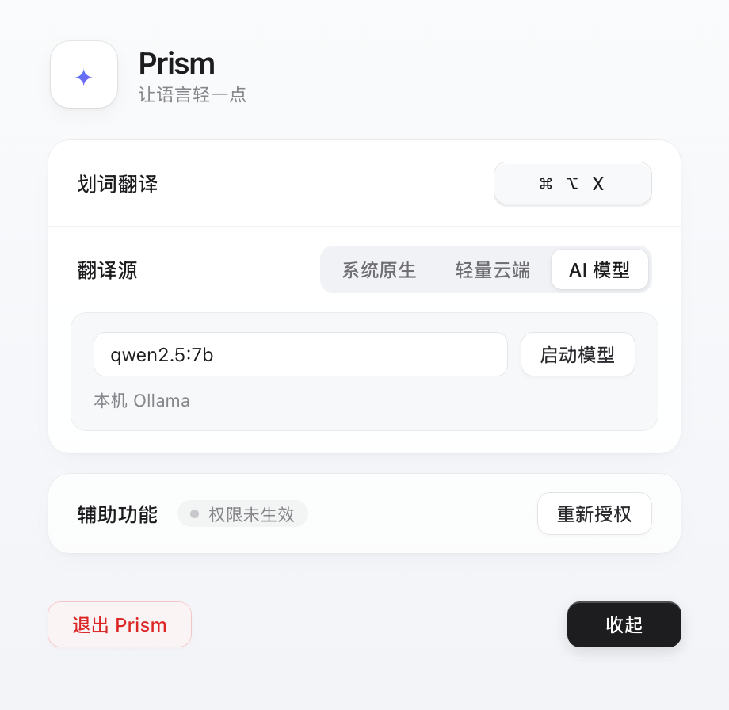

# Prism

**Mac 划词翻译工具。选中文字，按 ⌘ ⌥ X，译文就会出现在鼠标旁边。**

读网页、看 PDF、写代码时，Prism 可以帮你快速看懂一段外语。看完点一下别处，浮窗就会收起，继续手头的工作。

支持 Apple 系统翻译、Google 轻量云端和本机 Ollama 模型。主页面可以调整设置、管理授权；关掉主页面后，软件留在后台，菜单栏和 Dock 都不会显示图标，快捷键仍然可用。

[下载最新版](https://github.com/decous37/Prism/releases/latest) · [查看源代码](https://github.com/decous37/Prism) · [反馈问题](https://github.com/decous37/Prism/issues)

## 界面预览

以下截图来自 v1.5.0 安装包中的原生窗口。浮窗里的中文是系统原生翻译的真实返回。

**主页面**：修改快捷键、选择翻译源、启动本机模型和管理辅助功能授权。



**翻译浮窗**：语言选择和操作按钮放在顶部，下面展示译文。长译文可以滚动查看。


**浮窗设置**：点击齿轮，就能调整快捷键和翻译源。


## 下载与安装

需要 **macOS 15 或更高版本、Apple Silicon（M 系列芯片）**。安装包已包含 Python 和所需组件，普通使用无需配置开发环境。

1. 从 [Releases](https://github.com/decous37/Prism/releases/latest) 下载 **Prism-macOS-arm64.dmg**。
2. 打开镜像，把 **Prism** 拖进 **Applications（应用程序）**。升级时先退出旧版本，再选择替换。
3. 从应用程序中打开 Prism，点击主页面的 **重新授权**。
4. 在 **系统设置 → 隐私与安全性 → 辅助功能** 中开启 **Prism**，回到主页面确认显示“已授权”。
5. 在其他应用中选中文字，按 **⌘ ⌥ X** 翻译。

**第一次使用建议先试“轻量云端”**，无需下载语言资源或模型，前提是当前网络可以连接 Google。程序默认翻译源仍为“系统原生”，可以在主页面或浮窗设置中切换。轻量云端遇到限流时，可以按下方步骤准备本地翻译。

当前安装包使用本地签名，尚未经过 Apple 公证。首次打开时，如果 macOS 提示无法验证开发者，确认文件来自本仓库后，可以在 **系统设置 → 隐私与安全性** 中选择“仍要打开”。

## 日常使用

Prism 会自动识别选中文字的语言：中文默认译成英文，英语、日语、法语、韩语等外语默认译成简体中文。

点击浮窗顶部的语言名称，可以分别修改原文和译文语言。列表使用中文名称，最多显示五行，其余选项滚动查看。选择后会重新翻译原来选中的文字；下一次选词时恢复自动识别。

| 操作 | 效果 |
| --- | --- |
| 点击朗读 | 朗读当前译文 |
| 点击复制 | 复制译文，显示绿色“已复制” |
| 按 Enter | 复制译文，显示确认后收起浮窗 |
| 按 Esc、点击 × 或点击浮窗外 | 收起浮窗，继续后台运行 |
| 拖动卡片空白处 | 移动浮窗 |
| 点击齿轮 | 展开浮窗设置 |

主页面和翻译浮窗是两个独立窗口。主页面打开时会显示在 Dock，可以通过 **⌘ Tab** 切换。点击“收起”或关闭主页面后，Prism 留在后台。需要再次调整设置时，从应用程序中打开 Prism 即可。

要完全退出软件，请在主页面点击 **退出 Prism**。

## 选择翻译源

| 翻译源 | 使用前需要准备 | 适合的情况 |
| --- | --- | --- |
| 轻量云端 | 能连接 Google 的网络 | 初次试用，不想先下载资源 |
| 系统原生 | 下载原文和译文对应的语言资源 | 日常使用、离线翻译 |
| AI 模型 | 安装 Ollama，下载并启动模型 | 想使用本机大模型翻译 |

### 轻量云端

通过 Google 翻译接口获取译文，无需填写 API Key。选中的文字会发送到 Google，网络状况和接口限流会影响使用。

如果提示“Google 暂时限制了当前网络的翻译请求”，请等待提示的时间后再试。Prism 会控制请求间隔、复用重复译文，并在限流后暂停新请求；这些措施能减少触发，恢复时间仍由 Google 决定。同一网络出口的其他流量也可能影响限流。

需要继续工作时，可以切换到已准备好的系统原生或本机 AI 翻译。

### 系统原生：先下载语言资源

使用 Apple Translation 在本机翻译。**使用前要下载原文和译文两侧的语言资源**，例如中英互译需要中文和英语。

下载位置在 **系统设置 → 通用 → 语言与地区 → 翻译语言**：

1. 打开 Mac 的 **系统设置**，进入 **通用 → 语言与地区**。
2. 向下找到并点击 **翻译语言**。
3. 在需要的语言旁点击 **下载**。中英互译先下载中文和英语；要使用日语、法语或韩语，再下载对应语言。
4. 等待两侧资源都下载完成，点击 **完成**。
5. 回到 Prism，选择 **系统原生**，重新选中文字翻译。

首次翻译时，系统也可能弹出资源下载提示。支持哪些语言组合，取决于 macOS 的支持情况。

下载方法可参阅 [Apple 官方说明：在 Mac 上翻译文本](https://support.apple.com/zh-cn/guide/mac-help/mchldd8b3c15/mac)。

### AI 模型

默认连接本机 **Ollama**，使用 **qwen2.5:7b**。先安装 [Ollama](https://ollama.com)，再下载模型：

```sh
ollama pull qwen2.5:7b
```

在 Prism 中选择 **AI 模型**，点击 **启动模型**。软件会启动本机 Ollama 服务并加载已经下载的模型，准备完成后显示“模型已就绪”。也可以填写自己安装的其他模型名称。

首次加载需要一些时间，速度取决于模型大小和 Mac 的可用内存。关闭 Prism 后，模型可能继续驻留一段时间，由 Ollama 管理。

译文质量取决于模型。测试中，`qwen2.5:7b` 在部分中文译日语、韩语的样例里出现过原文残留或额外解释，可以与其他翻译源对照使用。

## 常见问题

**已经授权，为什么还显示“权限未生效”？**

本地签名的应用在升级后，旧授权可能失效。打开主页面，点击 **重新授权**，软件会清理自身的旧记录、重启并重新申请，再到系统设置中开启 Prism。主页面每两秒检查一次实际权限状态。

如果辅助功能列表里没有 Prism，点击列表下方的 **＋**，选择 `/Applications/Prism.app`。请始终运行应用程序中的这一份，避免混用构建目录里的副本。

**快捷键没有反应怎么办？**

先确认 Prism 仍在运行、主页面显示“已授权”。如果快捷键与其他软件冲突，可以点击快捷键按钮重新录制。部分应用可能无法读取选区，可以换一段文字或换个应用试试。

**支持哪些语言？**

语言菜单提供中文、英语、日语、法语、韩语等 29 个选项，各翻译源的实际支持情况有所不同。已有中英双向，以及日、法、韩分别与中英互译的固定样例，结果见 [语言测试](docs/language-tests.md)。

## 数据与设置

语言识别在本机完成。系统原生和本机 Ollama 使用本地组件；轻量云端或远程 AI 会把选中文字发送到对应服务。

Prism 优先通过辅助功能读取选区。需要借助复制取词时，会先备份剪贴板，读取后恢复；如果你随后复制了新内容，会保留你的新内容。

- 设置保存在 `~/.prism_config.json`。
- 日志保存在 `~/Library/Logs/Prism/prism.log`，不记录选中文字、译文或 API Key。

## 从源码运行

项目使用 Python、PyObjC 和 pywebview，两个界面由 HTML/CSS 编写，系统翻译通过 Swift 组件调用。

在 Apple Silicon Mac 上准备环境：

```sh
git clone https://github.com/decous37/Prism.git
cd Prism
xcode-select --install
brew install python@3.13
./scripts/bootstrap.sh
```

运行和打包：

```sh
.venv-build/bin/python main.py
./build_dmg.sh
```

构建需要 framework Python 3.12/3.13。输出在 `dist/`，包括应用、DMG 和校验文件。Release 也提供与版本对应的完整源码 ZIP。

运行检查：

```sh
.venv-build/bin/python -m unittest discover -s tests -v
node tests/frontend.cjs
node tests/main_frontend.cjs
```

前端文件是 **main.html**（主页面）和 **ui.html**（翻译浮窗），样式和脚本都写在各自文件内。窗口与前后端通信在 `main.py`，翻译逻辑在 `translator.py`，系统翻译组件在 `native/TranslationService.swift`。

远程 AI 配置、自定义签名和公证步骤见 [开发说明](docs/development.md)。

## 反馈

欢迎在 [Issues](https://github.com/decous37/Prism/issues) 提交问题或建议。请附上 macOS 版本、芯片型号、翻译源和复现步骤；涉及翻译内容时，可以用公开示例代替私人内容。
